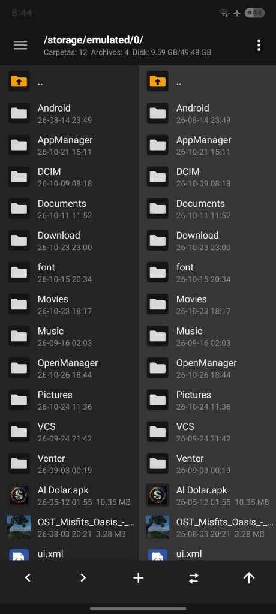
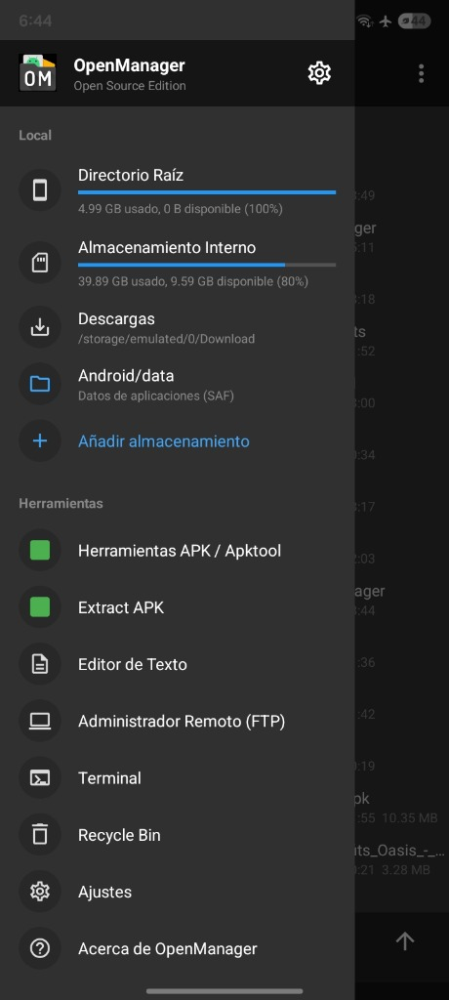
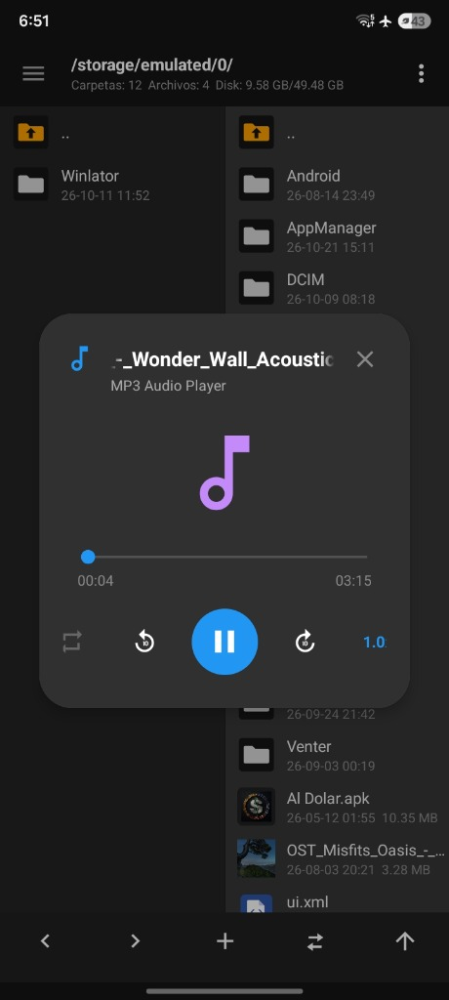
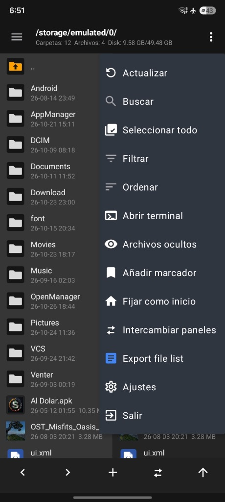

# OpenManager (Open Source Edition)

[](https://github.com/anhot11/OpenManager/actions)
[](https://github.com/anhot11/OpenManager/releases)
[](LICENSE)
[](https://android.com)

Un potente administrador de archivos de **código abierto**, moderno y con soporte de **doble panel (estilo MT Manager)** para Android 5.0+, equipado con herramientas integradas de ingeniería inversa, edición DEX Plus, editor HEX, descompilación Apktool, reproductor de audio flotante y soporte completo de superusuario (Root) y SAF.

---

[](https://github.com/anhot11/OpenManager/releases/latest)

> 📦 **Descarga directa:** [OpenManager-latest.apk](https://github.com/anhot11/OpenManager/releases/latest/download/OpenManager-latest.apk)

---

## 📸 Capturas de Pantalla (Preview)

<p align="center">
  
  
  
  
</p>

---

## ✨ Características Principales

### 🗂️ 1. Explorador de Doble Panel (Estilo MT Manager)
* **Doble Panel Independiente:** Visualiza y navega simultáneamente en dos directorios diferentes (Panel A y Panel B).
* **Operaciones Rápidas:** Copiado, movimiento y sincronización instantánea de archivos entre paneles opuestos.
* **Barra de Navegación (Breadcrumbs):** Ruta completa con acceso rápido a carpetas superiores y estadísticas de disco en tiempo real (Carpetas, Archivos, Espacio Usado y Total).
* **Navegación Fluida:** Intercambio rápido de paneles, fijar directorios de inicio y atajos directos a Descargas, Tarjeta SD y almacenamiento interno.

### 🛠️ 2. Suite de Edición e Ingeniería Inversa
* **Editor DEX & DEX Plus:**
  * Desensamblado y ensamblado Smali en tiempo real con motor integrado Baksmali/Smali.
  * Explorador jerárquico de paquetes, clases, métodos, campos y tabla de cadenas (`string_ids`).
  * Edición y guardado directo de cambios al archivo `.dex` con recompilación limpia.
* **Editor HEX Completo:**
  * Visualizador virtualizado ultra-fluido fila por fila (16 bytes por línea con offset, hexadecimal y representación ASCII).
  * **Inspector de Datos:** Interpretación en tiempo real en formatos Hexadecimal, Decimal, Int8, Int16 LE, Int32 LE, Float32, Binario y ASCII.
  * Búsqueda y reemplazo flexible de bytes hexadecimales o texto.
  * Historial completo de Deshacer / Rehacer, salto a offset y cálculo instantáneo de Checksums (MD5, SHA-1, SHA-256).
* **Herramientas APK y Apktool:**
  * Diálogo de información extendida de APK (nombre, paquete, versión, Target SDK, Min SDK, UID, ruta de APK y directorio de datos).
  * Descompilación y reconstrucción de recursos y código fuente con **Apktool**.
  * Firma digital con soporte para esquemas **V1 + V2 + V3** y verificación de certificados.
  * Extracción de APKs estándar y paquetes divididos (**Split APKs / APKS**).
  * Optimización de binarios con **Zipalign**.
* **Visor de Icono de Apps:**
  * Previsualización de iconos de APKs sobre fondo transparente integrado con el tema del menú (`#303030`).
  * Visor dedicado en alta resolución con detalle de dimensiones (ej. `512 × 512 px`).
  * Botón **"Guardar PNG"** para exportar el icono original directamente a `/sdcard/Download/<paquete>_icon.png`.
* **Editor de Texto & Código:**
  * Editor ligero integrado con resaltado de sintaxis, numeración de líneas y soporte de múltiples codificaciones.

### 🎵 3. Herramientas Multimedia y Sistema
* **Reproductor de Audio MP3 Flotante:**
  * Ventana modal integrada para reproducir pistas de audio sin abandonar la navegación.
  * Controles táctiles completos: Play/Pausa, salto rápido de ±10 segundos, selector de velocidad (`1.0x`, `1.25x`, `1.5x`, `2.0x`), barra de progreso interactiva y repetición.
* **Gestor de Aplicaciones (App Manager):**
  * Lista detallada de aplicaciones de usuario y de sistema con carga asíncrona de iconos vía Coil.
  * Búsqueda instantánea por nombre o paquete.
  * Acceso directo a directorios de datos (`/data/data/...`), directorio de instalación, extracción de APK y desinstalación.
* **Terminal Integrada:**
  * Acceso directo a shell local o Termux desde cualquier carpeta abierta con un solo toque.
* **Servidor Remoto y Red:**
  * Servidor FTP integrado para transferencias inalámbricas rápidas con PC o dispositivos locales.
  * Soporte cliente para FTP, SFTP, SMB y WebDAV.

### 🔒 4. Soporte Root & Storage Access Framework (SAF)
* **Soporte Root Completo:** Integración con Magisk, KernelSU y APatch mediante libsu para acceder a particiones protegidas (`/`, `/data`, `/system`).
* **Soporte SAF Automatizado:** Acceso sin restricciones a carpetas del sistema en Android moderno (`Android/data` y `Android/obb`).
* **Permisos Transparentes:**
  * Flujo secuencial inteligente: primero solicita el almacenamiento esencial y luego notificaciones opcionales.
  * Sin bloqueos ni diálogos molestos de "Abrir ajustes" al rechazar permisos opcionales.
  * Cierre automático de ventanas de solicitud (`auto-dismiss`) al conceder permisos.

---

## 🚀 Compilación desde el Código Fuente

Para compilar OpenManager localmente necesitas el JDK 21 y Android SDK configurado:

```bash
# Clonar el repositorio
git clone https://github.com/anhot11/OpenManager.git
cd OpenManager

# Compilar la APK en modo Debug
./gradlew assembleDebug

# La APK compilada se generará en:
# app/build/outputs/apk/debug/app-debug.apk
```

---

## 📜 Licencia

OpenManager se distribuye bajo los términos de la **Licencia Pública General GNU versión 3 (GPL v3)**.

```text
OpenManager - Open Source File Manager for Android
Copyright (C) 2018-2026 Hai Zhang, anhot11 & Colaboradores.

This program is free software: you can redistribute it and/or modify
it under the terms of the GNU General Public License as published by
the Free Software Foundation, either version 3 of the License, or
(at your option) any later version.

This program is distributed in the hope that it will be useful,
but WITHOUT ANY WARRANTY; without even the implied warranty of
MERCHANTABILITY or FITNESS FOR A PARTICULAR PURPOSE. See the
GNU General Public License for more details.
```
